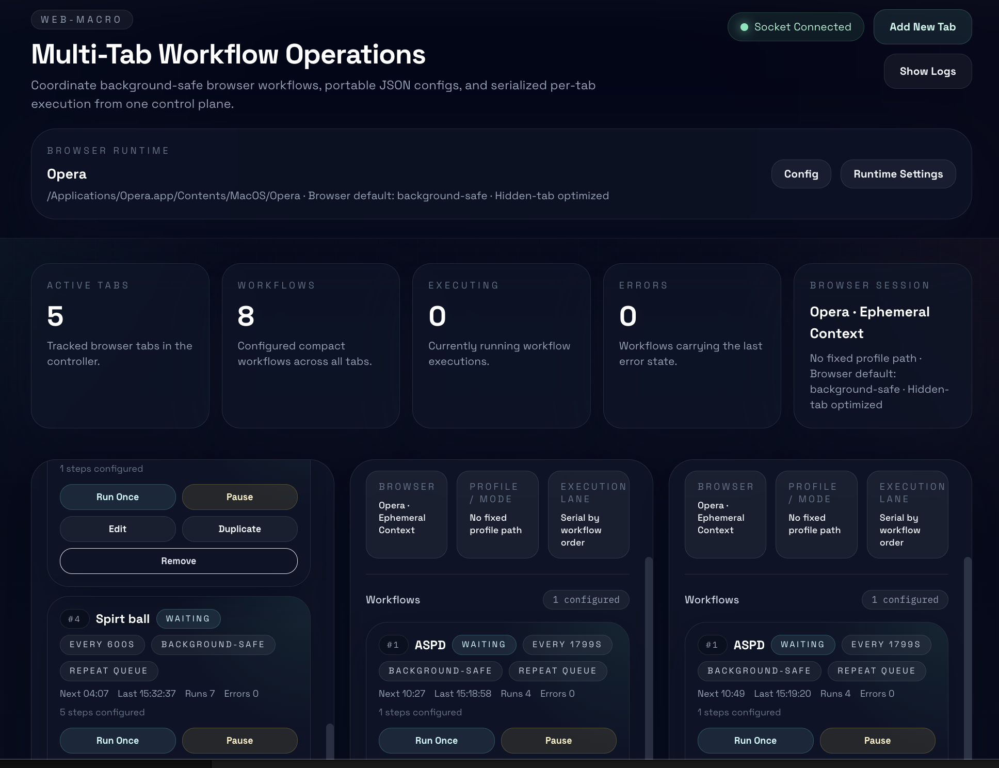
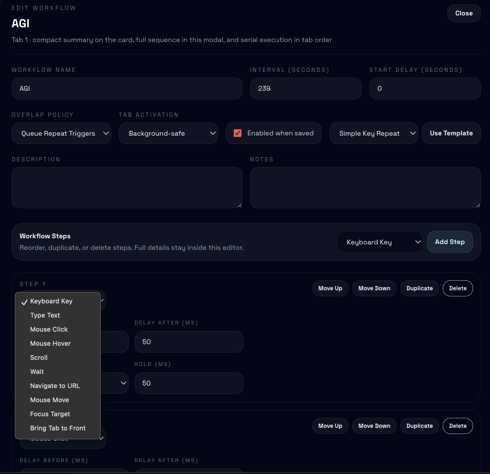
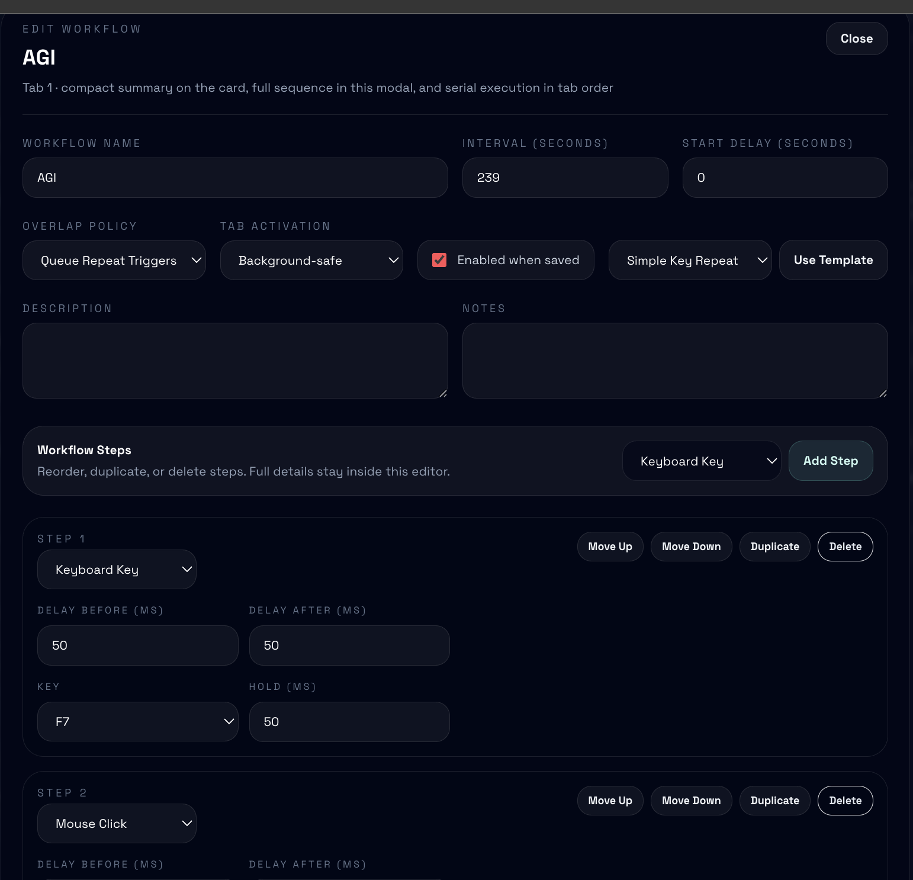
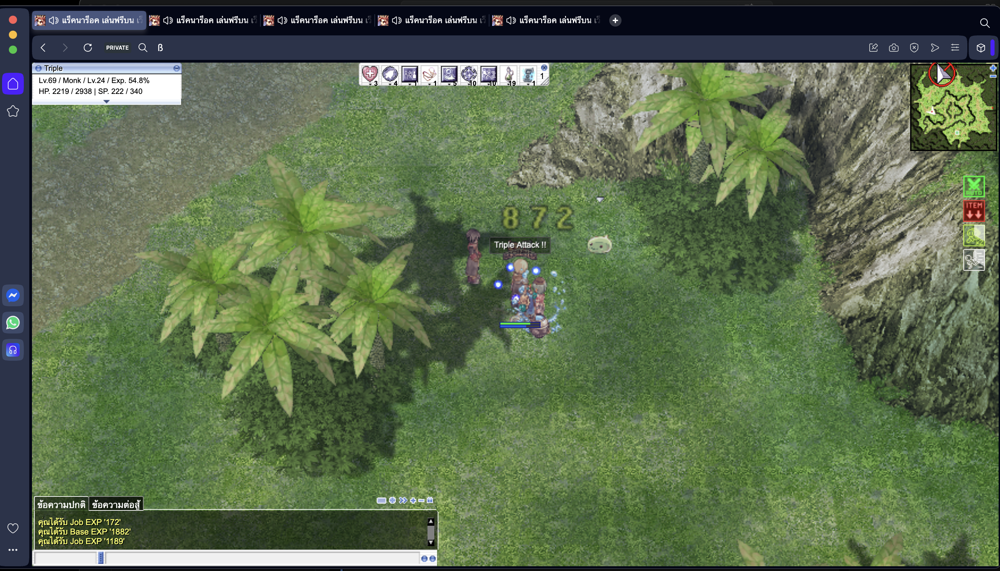

# web-macro

web-macro is a production-focused browser macro controller for games and browser workflows that need multi-tab orchestration, reliable background-safe input, and portable JSON configuration snapshots.

## Highlights

- Serial per-tab workflow execution so workflows on the same tab do not overlap.
- Background-safe browser automation with hidden-screen optimization controls.
- Compact dashboard for tabs, workflows, runtime settings, and logs.
- JSON config save, export, import, load, and delete flows for machine portability.
- Runtime defaults moved to port 3005 for the new codebase.

## Quick Start

1. Install dependencies:

```bash
npm install
```

The installer reuses detected Chrome, Edge, Brave, Chromium or Opera (or an
existing Playwright Chromium bundle) before attempting a browser download.
This lets Ubuntu 26.04 use an installed browser even when Playwright's bundled
Chromium downloader does not support that OS. If no browser is available and
the download fails, install one of these browsers, then rerun `npm install`.
No browser is installed system-wide by this project.

2. Start the controller on the default port:

```bash
npm run start
```

3. Open the dashboard:

```text
http://localhost:3005
```

4. Add a game tab, create workflows, and use Save Snapshot / Export JSON to preserve your setup.

## Scripts

- `npm run start`: start the controller on `PORT` or default `3005`; an occupied port is reported without killing its owner.
- `npm run dev`: start the controller without changing behavior from `start`.
- `npm run stop`: gracefully stop this checkout’s controller using its private local receipt; unrelated listeners are never killed.
- `npm run check`: syntax-check the browser input module, server, client app, and manifest.
- `npm test`: run headless browser regression tests using a detected installed browser.
- `npm run clean`: remove the disposable `user_data` and `opera_profile` directories; keep saved snapshots and controller stop receipts.

## Project Structure

- `server.js`: backend runtime, workflow scheduler, config storage, and Playwright integration.
- `public/index.html`: dashboard shell and modal markup.
- `public/app.js`: realtime dashboard behavior and workflow editor UI.
- `configs/`: saved JSON snapshots for browser/runtime/workflow state.
- `docs/`: architecture, usage, config portability, and production guidance.

## Documentation

- `docs/ARCHITECTURE.md`
- `docs/USAGE.md`
- `docs/CONFIGS.md`
- `docs/PRODUCTION.md`

## Notes

- This codebase intentionally omits CI/CD per current project scope.
- The original testing instance on port 3006 is not part of this new default runtime.
- Configs are portable JSON files and can be moved between machines directly or through the dashboard export/import flow.

## Screenshot






